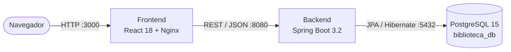
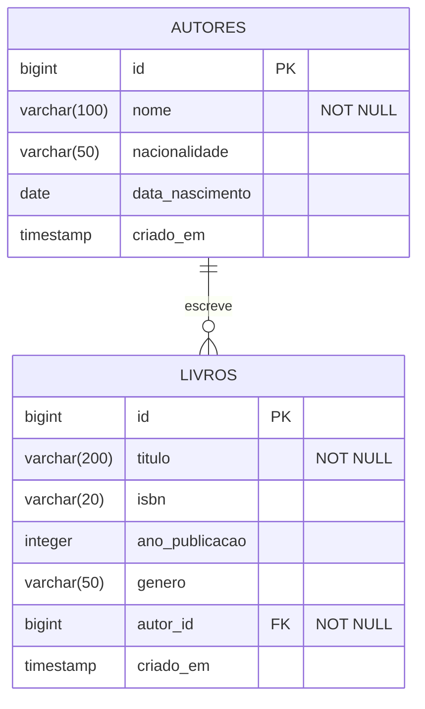

# Biblioteca Web

[](https://adoptium.net/)
[](https://spring.io/projects/spring-boot)
[](https://react.dev/)
[](https://www.postgresql.org/)
[](https://docs.docker.com/compose/)

Aplicação web full-stack para gerenciamento de **Autores** e **Livros**, com CRUD completo para ambas as entidades e relacionamento **1 : N** (um autor escreve vários livros; cada livro pertence obrigatoriamente a um autor).

Projeto desenvolvido na disciplina de **Engenharia de Software** (Prof. Sandro Laudares), reproduzindo o fluxo completo de engenharia: modelagem relacional, API REST, interface SPA, testes automatizados (unitários, integração e aceitação), containerização e pipeline CI/CD.

---

## Sumário

- [Arquitetura](#arquitetura)
- [Stack Tecnológica](#stack-tecnológica)
- [Modelo de Dados](#modelo-de-dados)
- [Estrutura do Projeto](#estrutura-do-projeto)
- [Como Executar](#como-executar)
- [Documentação da API](#documentação-da-api)
- [Testes Automatizados](#testes-automatizados)
- [Integração Contínua (CI)](#integração-contínua-ci)
- [Equipe e Divisão de Trabalho](#equipe-e-divisão-de-trabalho)

---

## Arquitetura



- **Frontend:** Single Page Application (SPA) em React 18 com React Router 6 e Axios, servida em produção por Nginx (multi-stage build).
- **Backend:** API RESTful em Spring Boot 3.2 seguindo separação em camadas (`controller`, `repository`, `model`), com validação declarativa (`jakarta.validation`) e documentação interativa via OpenAPI/Swagger.
- **Persistência:** PostgreSQL 15 em desenvolvimento/containers e H2 em memória no perfil `test`.

---

## Stack Tecnológica

| Camada | Tecnologias |
|---|---|
| **Backend** | Java 17, Spring Boot 3.2.5 (Web, Data JPA, Validation), Lombok, Springdoc OpenAPI (Swagger), Maven |
| **Frontend** | React 18, React Router 6, Axios, Node.js 20, Nginx |
| **Banco de Dados** | PostgreSQL 15 (produção/dev) e H2 em memória (perfil `test`) |
| **Testes** | JUnit 5, Mockito (`@WebMvcTest`, `@MockBean`, `MockMvc`), `@SpringBootTest`, Jest |
| **Containers** | Docker (multi-stage builds) e Docker Compose |
| **Versionamento & CI** | Git (Feature Branch + Pull Requests com Code Review) e GitHub Actions |

---

## Modelo de Dados



> **Decisão de design:** o relacionamento `@ManyToOne` é mantido apenas no lado `Livro` (`autor_id`), evitando serialização cíclica no JSON (`Autor → Livros → Autor`). A integridade referencial impede a exclusão de autores com livros vinculados (retornando HTTP `409 Conflict`).

---

## Estrutura do Projeto

```text
biblioteca-web/
├── .github/
│   └── workflows/
│       └── ci-cd.yml                 # Pipeline CI (backend, frontend e aceitação)
├── backend/
│   ├── Dockerfile                    # Build Maven (Java 17) + runtime JRE 17
│   ├── pom.xml
│   └── src/
│       ├── main/
│       │   ├── java/com/biblioteca/
│       │   │   ├── BibliotecaApplication.java
│       │   │   ├── controller/       # AutorController, LivroController
│       │   │   ├── model/            # Autor, Livro
│       │   │   └── repository/       # AutorRepository, LivroRepository
│       │   └── resources/
│       │       └── application.properties
│       └── test/
│           ├── java/com/biblioteca/
│           │   ├── controller/       # AutorControllerTest, LivroControllerTest
│           │   └── IntegracaoTest.java
│           └── resources/
│               └── application-test.properties
├── frontend/
│   ├── Dockerfile                    # Build Node 20 + Nginx Alpine
│   ├── nginx.conf                    # Fallback SPA (try_files)
│   ├── package.json
│   ├── package-lock.json
│   ├── public/
│   └── src/
│       ├── components/               # AutorList, AutorForm, LivroList, LivroForm
│       ├── services/
│       │   └── api.js                # Cliente Axios (autorService, livroService)
│       ├── App.css
│       ├── App.js                    # Navegação e rotas
│       └── index.js
├── docker-compose.yml                # Orquestração: postgres, backend, frontend
├── .gitignore
└── README.md
```

---

## Como Executar

### Opção 1: Docker Compose (recomendado)

Pré-requisitos: **Docker** e **Docker Compose**.

```bash
git clone <url-do-repositorio>
cd biblioteca-web
docker compose up -d --build
```

Após a inicialização, os serviços ficam disponíveis em:

| Serviço | URL |
|---|---|
| **Frontend (React)** | http://localhost:3000 |
| **API REST (Spring Boot)** | http://localhost:8080/api/autores |
| **Swagger UI (OpenAPI)** | http://localhost:8080/swagger-ui.html |
| **PostgreSQL 15** | `localhost:5432` (`biblioteca_db` / `postgres` / `postgres`) |

Para encerrar os containers:

```bash
docker compose down        # preserva o volume do banco
docker compose down -v     # remove containers e dados do banco
```

### Opção 2: Execução local (desenvolvimento)

Pré-requisitos: **Java 17**, **Maven 3.9+**, **Node.js 20+** e **PostgreSQL 15**.

1. **Banco de dados** (via container ou instância local com banco `biblioteca_db`):
   ```bash
   docker compose up -d postgres
   ```
2. **Backend:**
   ```bash
   cd backend
   mvn spring-boot:run
   ```
3. **Frontend:**
   ```bash
   cd frontend
   npm ci
   npm start
   ```

### Variáveis de Ambiente

| Variável | Serviço | Valor padrão | Descrição |
|---|---|---|---|
| `DB_URL` | Backend | `jdbc:postgresql://localhost:5432/biblioteca_db` | URL JDBC do PostgreSQL |
| `DB_USER` | Backend | `postgres` | Usuário do banco |
| `DB_PASSWORD` | Backend | `postgres` | Senha do banco |
| `REACT_APP_API_URL` | Frontend | `http://localhost:8080/api` | URL base da API REST |

---

## Documentação da API

A especificação interativa completa pode ser acessada via Swagger em `http://localhost:8080/swagger-ui.html`.

### Autores (`/api/autores`)

| Método | Endpoint | Descrição | Códigos HTTP |
|---|---|---|---|
| `POST` | `/api/autores` | Cria um novo autor | `201`, `400` |
| `GET` | `/api/autores` | Lista todos os autores ordenados por nome | `200` |
| `GET` | `/api/autores/{id}` | Busca um autor por ID | `200`, `404` |
| `PUT` | `/api/autores/{id}` | Atualiza os dados de um autor | `200`, `400`, `404` |
| `DELETE` | `/api/autores/{id}` | Remove um autor (`409` se possuir livros) | `200`, `404`, `409` |

### Livros (`/api/livros`)

| Método | Endpoint | Descrição | Códigos HTTP |
|---|---|---|---|
| `POST` | `/api/livros` | Cria um livro vinculado a um autor | `201`, `400` |
| `GET` | `/api/livros` | Lista todos os livros ordenados por título | `200` |
| `GET` | `/api/livros/{id}` | Busca um livro por ID | `200`, `404` |
| `PUT` | `/api/livros/{id}` | Atualiza um livro (incluindo o autor) | `200`, `400`, `404` |
| `DELETE` | `/api/livros/{id}` | Remove um livro | `200`, `404` |
| `GET` | `/api/livros/autor/{autorId}` | Lista os livros de um autor específico *(extra)* | `200` |

### Exemplos com `curl`

Criar um autor:

```bash
curl -X POST http://localhost:8080/api/autores \
  -H "Content-Type: application/json" \
  -d '{
    "nome": "Machado de Assis",
    "nacionalidade": "Brasileira",
    "dataNascimento": "1839-06-21"
  }'
```

Criar um livro vinculado ao autor de `id = 1`:

```bash
curl -X POST http://localhost:8080/api/livros \
  -H "Content-Type: application/json" \
  -d '{
    "titulo": "Dom Casmurro",
    "isbn": "978-8535910667",
    "anoPublicacao": 1899,
    "genero": "Romance",
    "autor": { "id": 1 }
  }'
```

---

## Testes Automatizados

### Backend (JUnit 5 + Mockito + H2)

```bash
cd backend

# Todos os testes (unitários + integração)
mvn test

# Apenas testes unitários dos controllers (@WebMvcTest + @MockBean)
mvn test -Dtest="*ControllerTest"

# Apenas testes de integração (@SpringBootTest + perfil test/H2)
mvn test -Dtest="IntegracaoTest"
```

Cobertura implementada:
- **`AutorControllerTest`:** criação (`201`), busca inexistente (`404`) e listagem ordenada por nome.
- **`LivroControllerTest`:** criação vinculada a autor (`201`), busca inexistente (`404`), validação sem autor (`400`) e listagem ordenada por título.
- **`IntegracaoTest`:** vínculo real `Livro → Autor` em banco H2 e fluxo CRUD completo de `Autor`.

### Frontend (Jest + Build)

```bash
cd frontend
npm test -- --watchAll=false --passWithNoTests
npm run build
```

---

## Integração Contínua (CI)

O workflow em [`.github/workflows/ci-cd.yml`](.github/workflows/ci-cd.yml) é disparado em todo `push` e `pull_request` para a branch `main` e executa três jobs:

1. **`test-backend`:** configura JDK 17 (Temurin), cache Maven e executa `mvn -B test`.
2. **`test-frontend`:** configura Node.js 20, instala dependências com `npm ci`, executa testes Jest e valida o build de produção (`npm run build`).
3. **`acceptance` *(extra)*:** sobe toda a stack com `docker compose up -d --build`, cria um autor e um livro vinculado via `curl`, verifica a resposta do frontend e derruba os containers.

---

## Equipe e Divisão de Trabalho

| Integrante | Papel | Responsabilidades | Branch |
|---|---|---|---|
| **Filipe Nery Rabelo** | DEV 1 | CRUD de Autores (`Autor`, `AutorRepository`, `AutorController`, `AutorControllerTest`, `AutorList.js`, `AutorForm.js`) e estrutura inicial | `feature/autores` |
| **Gabriel Henrique Pereira Carvalhaes** | DEV 2 | CRUD de Livros (`Livro`, `LivroRepository`, `LivroController`, `LivroControllerTest`, `LivroList.js`, `LivroForm.js`) e vínculo 1:N | `feature/livros` |

Arquivos compartilhados (`api.js`, `App.js`, `docker-compose.yml`, `.github/workflows/ci-cd.yml` e `README.md`) foram integrados em conjunto via Pull Requests com Code Review mútuo.
